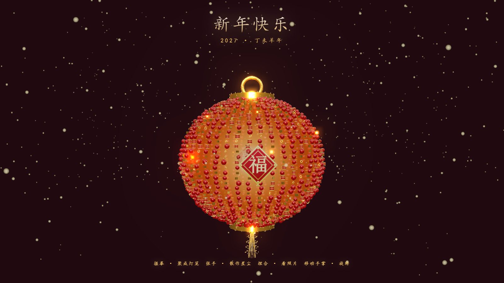

# 2027 羊年手势灯笼

一个只在桌面浏览器运行的手势互动网页：握拳把红色珠串聚成一盏球形灯笼，张手散成金色星尘，移动手掌旋转。设置页可上传自己的照片；照片在灯笼成型时隐藏，张手炸开时以正方形小缩略图出现，捏合按上传顺序展开原比例照片。

> 2026-11-25 修订：移除小羊、三张挂件卡和照片上传；灯笼改为球形珠串 + 金色上下盖/提手/流苏 + 内部暖光；球壳散开瞬间隐藏、聚合后淡入；烟花线宽减半。
> 2026-11-25 三改：金色手提、上下盖、流苏保留原来的实心形状，外层覆盖约 188 个小金铜钱粒子，整体更松弛。
> 2026-11-25 四改：福字贴改成菱形；灯笼横向外扩（横向半径 9.6、纵向缩放 0.9），弧度更饱满。
> 2026-11-25 五改：灯笼整体上移约 10px；菱形福字贴放大到 4.8×4.8。
> 2026-11-25 六改：恢复照片上传；照片在灯笼成型时隐藏、张手炸开时以正方形缩略图显示、捏合按上传顺序展开原比例照片。
> 2026-11-25 七改：手势改为“伸直手指数 + 连续 3 帧稳定”，握拳不再因手移动误触发炸开；散开缩略图再缩 20%（0.68），捏合展开再缩 30%（1.12 高）。
> 2026-11-26 八改：福字改为 2 个粒子（炸开散开/聚合归位）；金色上下盖/手提/流苏炸开时隐藏、聚合时从屏幕上下进入；全部到位后橙光才淡入。
> 2026-11-26 九改：福字回到贴合位置 z=±9.65（曲面半径 9.7），聚合时强制正向；TREE 时两张福都画在最上层、始终保留，按朝向计算透明度（正面 1.0、背面/侧面 0.35），背面福透过灯笼可见；侧面/背面允许翘边。
> 2026-11-26 十改：橙光在粒子稳定后等待 1400ms（比原来晚 1 秒）才出现。
> 2026-11-26 十一改：手势完全回到原版 avgDist 阈值（握拳 <0.25、张手 >0.4）+ 捏合 0.05/0.08，去掉伸指计数/3 帧。
> 2026-11-26 十二改：攥拳与捏合冲突——先判握拳（avgDist <0.25），再判捏合；攥拳时拇指/食指再近也不会误开照片。



## 运行

需要 Chrome / Edge 和摄像头。

```bash
cd 01-项目/2027羊年手势灯笼
python -m http.server 8000
```

浏览器打开 `http://localhost:8000`，允许摄像头。

不能直接双击 `index.html` 打开——ES Module 和摄像头权限都需要本地服务器。

## 操作

- 握拳：聚成灯笼（四指到手腕平均距离 < 0.25）
- 张开手掌：散成金色星尘（平均距离 > 0.4）
- 捏合：按上传顺序打开下一张照片（一轮内不重复；先判握拳，攥拳时不会误触发）
- 移动手掌：散开状态下旋转
- 鼠标点击：切换聚拢 / 散开
- 空格：切换聚拢 / 散开
- `H`：隐藏全部 UI（录屏用）
- `P`：开关摄像头预览
- `R`：重置到灯笼
- `1 / 2 / 3`：调试（灯笼 / 散开 / 随机照片）
- 设置页可上传背景音乐
- 摄像头被拒绝或模型加载失败时，用鼠标 / 空格继续

## 文件结构

```
index.html                 主程序（基于原版单文件改）
js/lantern.js              球形珠串与粒子类型（纯逻辑，可单测）
js/gestures.js             手势阈值与状态机（纯逻辑，可单测）
tests/                     Node 单元测试
assets/                    手势模型、wasm、福字贴片；其余插画保留未用
reference/                 原版 HTML 备份（对照与署名）
preview.png                成品截图
```

设计与实现计划为本地文件，已通过 `.gitignore` 排除，不随仓库提交。

当前页面使用 `assets/fu.svg`（菱形福字贴）；`fu-medallion.svg`、`fuwa-fish.svg`、`firecracker.svg`、`sheep-couplet.svg` 保留在素材目录，不再加载。

## 资源与网络

- 手势模型 `assets/models/hand_landmarker.task` 和 `assets/wasm/` 在本地，运行时不请求 Google。
- Three.js / MediaPipe 的 JS 走 jsdelivr；其余全部本地。
- 灯笼正反面保留菱形金色「福」字贴片；如果不需要，可以再删。

## 验收记录（2026-11-25）

- `npm test`：12 / 12 通过（外扩椭球珠串、网格唯一性、手势阈值（原版 avgDist）、聚焦循环）。
- 无头 Chrome 1600×900：`HandLandmarker ready`；粒子统计只有 `redBead / goldCube / miniLantern / coin`，没有卡片。
- 金色硬件：手提、上下盖、流苏是“实心金色底 + 约 188 个小金铜钱表层”，作为上下两组网格；主体 1800 + 2 个福字粒子 = 1802 个粒子。
- 福字贴片改为菱形（`fu.svg`）；灯笼横向半径 9.6、纵向缩放 0.9，宽约 19.2、高约 16.8，侧面弧度更饱满。
- 灯笼整体上移约 10px（`mainGroup.y` -1.0 → -0.6）；菱形福字贴从 4×4 放大到 4.8×4.8。
- 聚合时序：SCATTER 时福字作为 2 个粒子散开（FU=2）、金色硬件隐藏、球壳瞬间隐藏；TREE 时金色上/下组从 ±24 进入（约 900ms），福字归位；随后等所有粒子稳定（最远粒子到目标 <0.6，且持续 1400ms，比之前晚 1 秒），橙壳才淡入。实测 1.0s/1.6s/2.2s 仍为 0，2.8s 到 0.30，3.4s 0.319，最终 0.32。
- 福字贴片：TREE 时正面 `(0,0,9.65)` rot `(0,0,0)`，背面 `(0,0,-9.65)` rot `(0,π,0)`；曲面贴片、正向；TREE 时两张福都画在最上层、始终显示，按朝向算透明度（正面 1.0、背面/侧面 0.35），背面福透过灯笼可见；正面不被珠子盖住、不悬空；侧面/背面允许翘边。
- 小羊、三张挂件卡已从页面移除；照片上传已恢复；页面保留球形灯笼、标题、提示、照片和背景音乐。
- 照片行为：TREE 时两张测试图 `visible=false`；张手 SCATTER 时 `true`、始终面向镜头，缩略图为 0.68×0.68 正方形；捏合（或 `3`）按上传顺序打开（0→1→0…），聚焦卡片恢复原比例（测试图 1.991×1.12）；回到 TREE 时再次隐藏。
- 手势：完全沿用原版 avgDist 阈值（握拳 <0.25、张手 >0.4）+ 捏合 0.05/0.08；去掉伸指计数/3 帧；先判握拳再判捏合，修复攥拳误开照片。
- 点击、空格、`H`、`P`、`R`、摄像头拒绝、模型失败、SVG 缺失兜底、构图和网络检查均通过。
- 烟花线宽在原来的基础上减半（willow 3/2 → 1.5/1；shell 8/3 → 4/1.5）。
- 帧率参考：无头 Chrome（SwiftShader 软件渲染）1280×720 约 47.9fps；真实 GPU 应更高。
- 未覆盖：真实手部动作。无头环境使用假摄像头，只验证了模型加载、阈值单测和状态机；握拳/张手需要你用真实摄像头再试一次。

## 署名与许可

二创自手势圣诞树原版：

https://github.com/echoezy9527/christmas-tree-generated-by-gemini-3

原作者：国内某厂 AI 产品经理（@echoezy9527）。原版采用 Apache 2.0 许可；本二创保留 `LICENSE`，公开发布请注明原作者。

## 常见问题

- 摄像头没反应：确认用 `http://localhost:8000` 打开，并在浏览器地址栏允许摄像头。
- 模型加载失败：页面会提示「手势模型加载失败，使用鼠标模式」，可用鼠标或空格继续。
- 照片不显示：灯笼成型时照片是隐藏的（按设计），张手散开才会出现；捏合按顺序打开下一张。
- 手势误触：手势已完全回到原版——握拳 <0.25、张手 >0.4、捏合 0.05/0.08；攥拳优先于捏合，攥拳时不会误开照片；如果还觉得敏感，可以再统一加 2 帧防抖。
- 改了手势但效果没变：先强制刷新（Ctrl+Shift+R）。JS 模块已加版本号，防止浏览器继续用缓存的旧 `gestures.js`；如果刷新后还不对，再检查摄像头距离和光线。
- 手机端：不支持，第一版只做桌面。
- 想改珠子密度/灯笼大小：调 `js/lantern.js` 的 `rows/cols/maxRadius` 和 `index.html` 里的珠子缩放；要换福字贴片，替换 `assets/fu-medallion.svg`。
